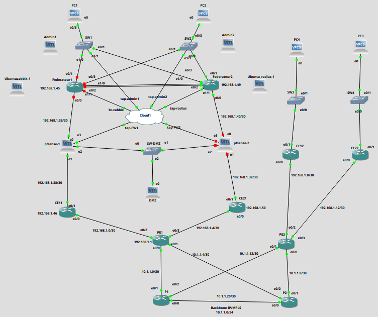

## Project Context

This project simulates the core infrastructure of a Next-Generation Network (NGN) enterprise operator and its multi-site branches (Main HQ, Redundant HQ, Branch1, Branch2). The objective was to master high-speed transport, logical segmentation, network redundancy, and overall hardening of both management and control planes.

## Architecture & Technical Achievements

### 1. Core Network & IP/MPLS Backbone
- **Transport & Switching:** Deployed an MPLS core leveraging Provider (`P1`, `P2`) and Provider Edge (`PE1`, `PE2`) routers.
- **Infrastructure Routing:** Deployed **OSPF** for internal core convergence and **LDP** (*Label Distribution Protocol*) for Label Switched Path (LSP) allocation.
- **Virtualization & Isolation:** Implemented inter-PE VPNv4 route exchange via **MP-BGP** and strict traffic isolation using **VRF** routing tables.

### 2. Multi-Site Infrastructure & High Availability
- **HQ Switching:** Configured Inter-VLAN routing on Layer 3 core switches, **EtherChannel** link aggregation (Trunk mode), and VLAN segmentation (Data, Management, DMZ).
- **Gateway Redundancy:** Implemented **HSRP/VRRP** on core switches to ensure seamless default gateway failover for end users.
- **Network Services:** Deployed centralized DHCP services on core switches for all production VLANs.

### 3. Governance, AAA & Centralized Monitoring
- **AAA Management / FreeRADIUS:** Centralized Authentication, Authorization, and Accounting via a **FreeRADIUS** server (with fallback local accounts for resilience).
- **Management Hardening:** Enforced VTY/SSH access restrictions using targeted **ACLs** (permitting access exclusively from administration hosts `ADMIN1` Kali and `ADMIN2` Ubuntu).
- **Zabbix Telemetry & Infrastructure:** Secured real-time metrics collection via **SNMPv3** (MD5 encryption), centralized event logging through **Syslog**, and network-wide **NTP** time synchronization.

### 4. Perimeter Security, DMZ & IPS
- **High-Availability pfSense Firewalls:** Deployed an Active/Standby firewall cluster providing transparent failover via **CARP** (*Common Address Redundancy Protocol*).
- **DMZ & Granular Access Control:** Hosted core enterprise services (SMTP, WWW, DNS) behind strict firewall policies across WAN, LAN, and DMZ interfaces (least privilege model).
- **Intrusion Prevention System (IPS):** Activated **Snort** in inline blocking mode on WAN interfaces with automated alert forwarding to Zabbix.

## Validation & Proof of Concept

- **MPLS Verification:** Validated OSPF/LDP neighbor adjacencies, MPLS forwarding tables (`show mpls forwarding-table`), MP-BGP VPNv4 peering, and traceroutes showing multi-label encapsulation.
- **Failover & Redundancy Testing:** Verified zero-downtime gateway transitions during simulated hardware outages (HSRP core switch failover & CARP VIP switchover).
- **Traffic Isolation:** Confirmed complete inter-LAN isolation while maintaining authorized remote branch access and administrator connectivity to the DMZ.