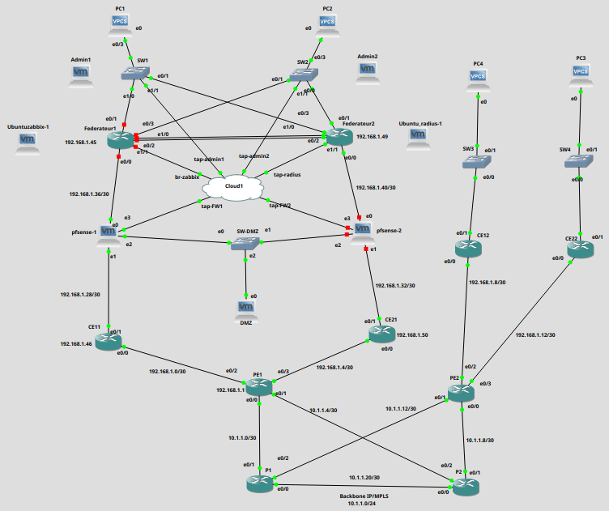

## Contexte du projet

Ce projet simule le cœur d'un réseau d'opérateur d'entreprise (Next Generation Network - NGN) et ses agences multi-sites (Siège principal, Siège redondant, Branch1, Branch2) pour maîtriser le transport haut débit, la segmentation logique, la redondance et la sécurisation globale du plan de management et de production.

## Architecture & Réalisations Techniques

### 1. Cœur de Réseau & Backbone IP/MPLS
- **Transport & Commutation :** Déploiement d'un cœur MPLS avec routeurs Provider (`P1`, `P2`) et Provider Edge (`PE1`, `PE2`).
- **Routage d'Infrastructure :** OSPF pour la convergence interne et LDP (*Label Distribution Protocol*) pour la distribution des étiquettes (LSP).
- **Virtualisation & Isolation :** Échange des routes VPNv4 inter-PE via **MP-BGP** et étanchéité logique des flux clients au moyen de tables de routage virtuelles **VRF**.

### 2. Infrastructure Multi-Sites & Haute Disponibilité
- **Commutation Siège :** Routage inter-VLAN sur switchs fédérateurs L3, agrégation de liens **EtherChannel** (mode Trunk) et segmentation (VLANs Data, Management, DMZ).
- **Redondance de Passerelle :** **HSRP/VRRP** configuré sur les fédérateurs pour assurer la continuité de service des passerelles utilisateurs.
- **Services Réseau :** DHCP centralisé sur les switchs fédérateurs pour les VLANs de production.

### 3. Gouvernance, AAA & Monitoring Centralisé
- **Gestion AAA / FreeRADIUS :** Authentification, autorisation et traçabilité centralisées via un serveur **FreeRADIUS** (avec fallback sur bases locales en cas de défaillance).
- **Hardening Management :** Restriction des accès distants SSH/VTY par **ACLs dédiées** (autorisant uniquement les stations d'admin `ADMIN1` Kali et `ADMIN2` Ubuntu).
- **Supervision Zabbix & Infrastructure :** Collecte sécurisée des métriques en temps réel via **SNMPv3** (chiffrement MD5), centralisation des événements par **Syslog** et synchronisation temporelle globale **NTP**.

### 4. Sécurité Périmétrique, Zone DMZ & IPS
- **Firewalls pfSense en Haute Disponibilité :** Cluster symétrique Active/Standby avec bascule automatique via le protocole **CARP** (*Common Address Redundancy Protocol*).
- **Zone DMZ & Filtrage Granulaire :** Hébergement des services publics (SMTP, WWW, DNS) sécurisés par des règles strictes sur les interfaces WAN/LAN/DMZ (isolation inter-LAN et moindre privilège).
- **Prévention d'Intrusion (IPS) :** Activation de **Snort** en mode inline sur les interfaces WAN pfSense avec remontée d'alertes en temps réel vers Zabbix.

## Résultats & Validation

- **Vérification MPLS :** Validation des adjacences OSPF/LDP, des tables de commutation (`mpls forwarding-table`), des sessions iBGP VPNv4 et des traceroutes montrant l'empilement de labels.
- **Tests de Bascule & Redondance :** Validation de la reprise transparente des passerelles lors des simulations de pannes (HSRP au niveau du Siège et CARP au niveau pfSense).
- **Isolation & Matrice de Flux :** Validation du blocage des communications directes inter-LAN tout en garantissant l'accès des agences distantes et des administrateurs à la zone DMZ.